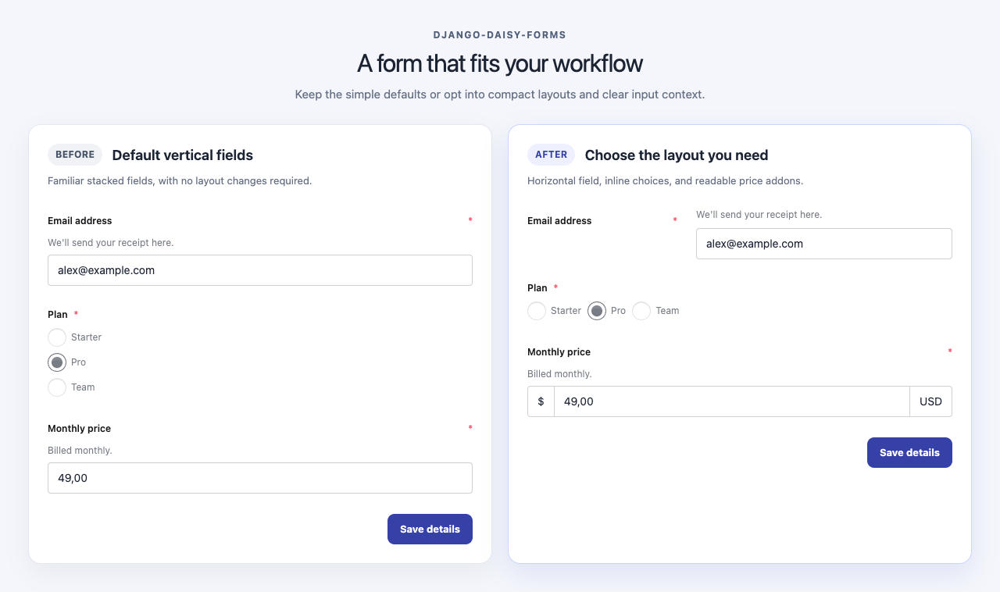

# Layouts & addons

Fields stay stacked by default. django-daisy-forms provides opt-in layouts for horizontal fields, inline choices, and text addons.



## Horizontal fields

The `field_horizontal.html` template places the label beside the control at larger breakpoints:

```django


```

On narrow screens, the label and control stack vertically. From the `md` breakpoint, they sit side by side.

To make every field horizontal, use `DaisyHorizontalFormRenderer`. Set it globally:

```python
FORM_RENDERER = "daisy_forms.renderers.DaisyHorizontalFormRenderer"
```

Or for one form, with Django's `default_renderer` attribute:

```python
from daisy_forms.renderers import DaisyHorizontalFormRenderer


class ProfileForm(forms.Form):
    default_renderer = DaisyHorizontalFormRenderer
```

`` still returns a single field to the stacked layout.


## Inline choices

For `RadioSelect` and `CheckboxSelectMultiple` widgets, use `choices="inline"` to lay out options in a wrapping row:

```django



```

The default choice layout is vertical.

Grouped choices (optgroups) render each group as `role="group"` with a heading that labels it, so screen readers announce the group name before its options.

### Restrictions

`choices="inline"` only works with:

- `RadioSelect` widgets
- `CheckboxSelectMultiple` widgets

It does **not** work with:

- `Select` widgets
- Widgets with custom choice templates
- Any other value besides `inline`

Unsupported combinations raise a `TemplateSyntaxError` at render time.

## Text addons

Use `prefix` and `suffix` to add text before or after an input:

```django



```

Addons are wrapped in a `join` container:

```html
<div class="join w-full">
  <span class="input join-item w-auto">$</span>
  <input type="number" name="price" step="any" required class="input join-item flex-1" id="id_price">
  <span class="input join-item w-auto">USD</span>
</div>
```

### Addon styling

Addons copy the input's daisyUI modifiers so the group renders as one control:

- Size: `input-sm`, `input-md`, `input-lg`, `input-xl`
- Color: `input-primary`, `input-secondary`, etc.
- Error: `input-error` when the field is invalid

Example with a small input:

```django

```

The addon spans get `input-sm` to match.

### Restrictions

`prefix` and `suffix` only work with:

- Stock, visible, single-line widgets rendered with daisyUI's `input` component
- `TextInput`, `EmailInput`, `URLInput`, `NumberInput`, `PasswordInput`
- `NativeDateInput`, `NativeTimeInput`, `NativeDateTimeInput`

They do **not** work with:

- Hidden inputs
- Checkboxes, radios, toggles
- File inputs
- Range inputs
- Color inputs
- Widgets with custom templates
- `Textarea`, `Select`, and other non-`input` widgets

Unsupported combinations raise a `TemplateSyntaxError` at render time.

### Text only

Addon values are escaped and do not accept HTML or icon markup:

```django

```

To use icons or complex markup, override the field template.

## Fieldsets

Declare a `fieldsets` attribute to group `{{ form }}` output into sections. The shape matches the Django admin's:

```python
class SignupForm(forms.Form):
    email = forms.EmailField()
    first_name = forms.CharField()
    last_name = forms.CharField()
    plan = forms.ChoiceField(choices=PLANS, widget=forms.RadioSelect)
    notes = forms.CharField(required=False)

    fieldsets = (
        ("Account", {
            "fields": ("email", ("first_name", "last_name")),
            "description": "Used to sign in.",
        }),
        ("Preferences", {"fields": ("plan",), "classes": ("collapse",)}),
    )
```

- Each entry renders a `<fieldset class="fieldset">` with a `fieldset-legend` and the escaped description.
- A tuple inside `fields` renders up to four fields side by side from the `md` breakpoint (`grid gap-4 md:grid-cols-N`). Fields in a row always use the stacked template, even under `DaisyHorizontalFormRenderer`, unless `daisy_fields` sets a `template`.
- `"collapse"` in `classes` renders the section as a daisyUI `collapse` on `<details>`, so it works without JavaScript. It opens automatically when one of its fields has an error. Other classes are added to the section.
- Visible fields that no fieldset lists render after the fieldsets, without a wrapper. Hidden fields always render at the end.
- An unknown or repeated field name, a malformed entry, or a row of more than four fields raises `ImproperlyConfigured` when the form renders.

Forms without `fieldsets` render exactly as before. Forms in a formset use their own `fieldsets`.

## Combining layouts

You can combine horizontal fields with inline choices and addons:

```django

<form method="post">
  
  <fieldset>
    <legend>Account</legend>
    
  </fieldset>
  <fieldset>
    <legend>Plan and features</legend>
    
    
  </fieldset>
  <fieldset>
    <legend>Pricing</legend>
    
  </fieldset>
  <div class="flex flex-col gap-3 sm:flex-row sm:justify-end">
    <button class="btn btn-ghost" type="reset">Reset</button>
    <button class="btn btn-primary" type="submit">Save</button>
  </div>
</form>
```

## Composed forms

When you need full control over the markup, use ordinary Django template markup to group fields and place actions:

```django

<form method="post">
  
  <fieldset>
    <legend>Account</legend>
    
  </fieldset>
  <div class="flex gap-3">
    <button class="btn btn-primary" type="submit">Save</button>
  </div>
</form>
```
