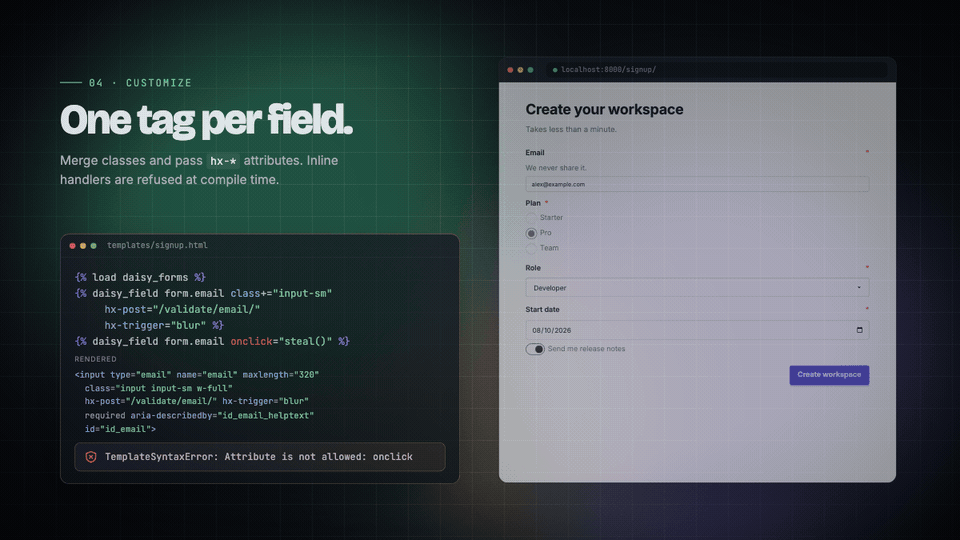

# Tailwind CSS integration

The package requires Tailwind CSS 4.1 or later and daisyUI 5.0.36 or later. Tailwind does not scan `site-packages`, so the package ships its classes as a source file that you generate in your project.



## The CSS contract

The package emits daisyUI classes like `input`, `select`, `checkbox`, and layout classes like `fieldset`, `fieldset-legend`, `join`, `join-item`. Tailwind needs to know about these classes to include them in the compiled CSS. Since Tailwind scans files as plain text and does not scan `site-packages`, the package provides a management command that generates an `@source inline()` file listing every class.

## Generating the CSS source file

Run the management command in your project:

```bash
python manage.py daisy_forms_css --output static/src/daisy-forms.css
```

This creates a file with an inline source listing every class the package emits. Commit this file to your repository.

## Importing the file

Import the generated file after Tailwind and daisyUI in your main CSS:

```css
@import "tailwindcss";
@plugin "daisyui";
@import "./daisy-forms.css";
```

## CI check

Use the `--check` flag to catch drift in CI:

```bash
python manage.py daisy_forms_css --output static/src/daisy-forms.css --check
```

This exits with status 1 if the file differs from what would be generated. Add this to your CI pipeline:

```yaml
- name: Check daisy-forms CSS
  run: python manage.py daisy_forms_css --output static/src/daisy-forms.css --check
```

## Upgrading the package

When upgrading, regenerate the CSS source file:

```bash
python manage.py daisy_forms_css --output static/src/daisy-forms.css
```

The generated file includes a header comment with the package version.

## Path-based source (local development only)

For local development, use a path-based source instead of inline():

```bash
python manage.py daisy_forms_css --print-source-path
```

Path-based `@source` breaks across virtual environments and containers, so use `inline()` for production.

## Template scanning

Tailwind scans files as plain text, so dynamically built class names are invisible. The package guarantees that every class literal appears in the generated file. If you override package templates, Tailwind scans them normally since they live in your project.

## Verifying the build

After generating the file and building your CSS, verify that the compiled CSS includes the package classes. `input-error` is a good probe: the package emits it for invalid fields, and projects rarely write it themselves:

```bash
grep -c "\.input-error" static/css/main.css
```

A count of zero means the generated file is not part of the build.

If the classes are missing, check that:

1. The generated file is imported after Tailwind and daisyUI
2. Tailwind is scanning the generated file
3. daisyUI is emitting the component CSS
